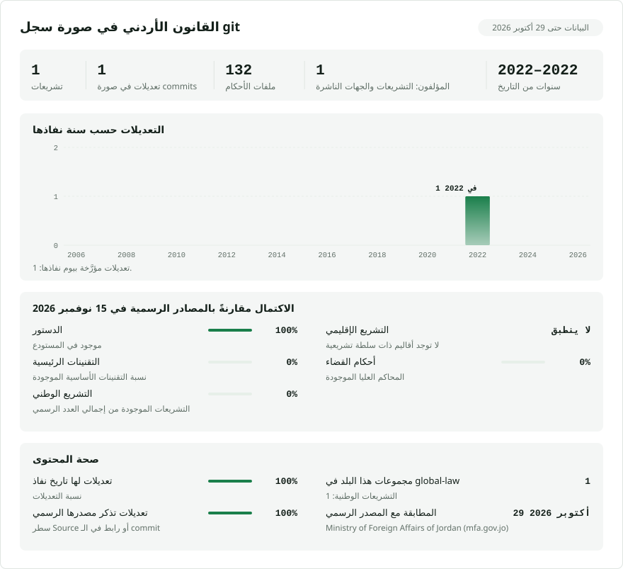

# الأردن: تاريخ القانون في git

**العربية** · [English](README.en.md)

<picture>
<source media="(prefers-color-scheme: dark)" srcset="data/ar/effort-dark.svg">

</picture>

القانون الأردني في صورة سجل git: ملف لكل حكم، ولكل نسخة commit واحد في يوم نفاذها، والتشريع الذي أجرى كل تعديل هو مؤلف الـ commit. يبيّن `git blame` التشريع الذي يقف وراء كل مادة؛ ويسرد `git log` كل تعديل طرأ على مادة؛ واختيار تاريخ ما يعطي النص النافذ في ذلك اليوم.

جزء من [lexifina/global-law](https://github.com/lexifina/global-law)، وهو سجل git واحد لقانون كل بلد: هذا هو القانون الوطني الأردني، الذي يقرؤه global-law في `jordan/national/acts/`.

**المحتوى الحالي:** الدستور (131 مادة) و3,584 نصًا آخر: 918 قانونًا (1923-2026)، و2,103 أنظمة، و479 تعليمات، و84 اتفاقية، من نسخ أرشيف الإنترنت لموقع ديوان التشريع والرأي ومن LawCodex/jo (نسخة ثانوية). ولا يوجد هنا بعدُ القانون المدني ولا قانون العقوبات ولا قانونا أصول المحاكمات ولا أي حكم قضائي. يبيّن [`STRUCTURE.md`](STRUCTURE.md) ترتيب المجلدات؛ ويبيّن [`REPRODUCE.md`](REPRODUCE.md) كيف أُعدّت الملفات الأولى.

كل تشريع مجلد، فيه ملف لكل حكم: `الدستور/art-001.md` هي المادة 1.

النصوص باللغة العربية، وهي اللغة الرسمية، كما تطبعها مصادرها. والترجمة الإنجليزية ليست جزءًا من هذا السجل.

## الأسئلة في صورة أوامر git

| السؤال | الأمر |
| --- | --- |
| كل تعديل طرأ على المادة 1 من الدستور | `git log -p --word-diff -- الدستور/art-001.md` |
| أي تشريع كتب كل سطر من المادة 1؟ | `git blame الدستور/art-001.md` |
| كل نسخ الدستور، مع يوم نفاذ كل منها | `git log --format="%h %(trailers:key=In-force,valueonly,separator=) %an" -- الدستور ":^الدستور/README.md"` |
| المادة 1 كما كانت نافذة في 1 كانون الثاني 2026 | `python tools/on.py 2026-01-01 الدستور art-001` |

**خارج git**، نستضيف هذا السجل أيضًا للعموم، مجانًا:

- **[اسأل Claude عن القانون الأردني](https://global-law.lexifina.com/v1/try_claude?country=jordan)**: يفتح Claude ومعه سؤال أول جاهز.
- **[اسأل ChatGPT](https://global-law.lexifina.com/v1/try_chatgpt?country=jordan)**: السؤال نفسه في ChatGPT.
- **[ابحث في القانون الأردني على موقعنا](https://lexifina.com/law?country=jordan&q=%D8%AD%D8%B1%D9%8A%D8%A9+%D8%A7%D9%84%D8%B1%D8%A3%D9%8A)**: بحث عن "حرية الرأي"، مع نص كل حكم ونسخه، دون الحاجة إلى حساب.
- **[واجهة REST API للمطوّرين](https://global-law.lexifina.com/v1/search_law?query=%D8%AD%D8%B1%D9%8A%D8%A9+%D8%A7%D9%84%D8%B1%D8%A3%D9%8A&jurisdiction=jordan)**: البحث نفسه بصيغة JSON، دون مفتاح. انظر [التوثيق هنا](https://lexifina.com/api/global-law).

يقرأ المساعدان كلاهما السجل عبر موصِّل Global law المجاني (MCP، `https://global-law.lexifina.com/mcp`)؛ وفي المرة الأولى تعطيك المحادثة الرابط الذي يضيفه. اسأل بالعربية أو بالإنجليزية.

**استضفه بنفسك بسهولة.** كل ما يلزم هو git وPython، والأدوات تعمل على جهازك:

```sh
git clone --depth 1 https://github.com/lexifina/global-law && cd global-law
python3 tools/countries.py add jordan/national/acts
python3 tools/law.py show 2026-01-01 jordan/national/acts/constitution/art-001.md
```

عند فتح النسخة المستنسخة في Claude Code أو Cursor أو VS Code أو Codex، تشغّل أيضًا خادم MCP محليًا بالأدوات نفسها ([MCP.md](https://github.com/lexifina/global-law/blob/main/MCP.md)).

## التواريخ

يحمل كل commit تاريخ الظهيرة، بتوقيت Asia/Amman، من اليوم الذي نفذت فيه النسخة، ويحمل هذا اليوم في تذييله (trailer) `In-force:`:

- تحمل النسخة الوحيدة للدستور تاريخ 31 كانون الثاني 2022، وهو تاريخ عدد الجريدة الرسمية الذي نُشر فيه آخر تعديل تتضمنه طبعة الوزارة (العدد 5770)، بوصفها أقدم نسخة متاحة. والنص أقدم من ذلك: فقد نُشر الدستور لأول مرة في 8 كانون الثاني 1952، ونصوصه السابقة غير متاحة على الإنترنت بوصفها نسخًا مستقلة. أي تاريخ قبل 31 كانون الثاني 2022 لا يعطي نصًا.

لا تُنسب أي نسخة إلى قانون. فالنسخة الوحيدة منسوبة إلى الجهة الناشرة، وزارة الخارجية الأردنية (mfa.gov.jo)، بوصفها "أقدم نسخة متاحة" (`Kind: publisher`). والمُودِع (committer) هو Lexifina.

## كيف يُتحقَّق منه

- يعيد `tools/check_repo.py` قراءة كل نسخة من git في يوم نفاذها وفي اليوم السابق له، ويقارنها بالمجموعة، التي توجد بصمتها (hash) في `data/corpus.sha256`؛ ويتحقق أيضًا من أن تذييلات كل commit قابلة للتحليل، وأن `main` خالٍ من commits الدمج، وأنه لا يوجد commit مؤرَّخ في المستقبل.
- يكتب `tools/build.py` السجل من ملف المجموعة الواحد هذا، والمجموعة نفسها تعطي بصمات الـ commits نفسها. ويسجّل [`REPRODUCE.md`](REPRODUCE.md) أن عمليات التحقق لم تُشغَّل بعد لهذا البناء وأنه لم تُقارَن به أي عملية بناء ثانية.
- توجد بصمة sha256 لملف PDF الذي استُخرج منه نص الدستور في `data/versions.json`.
- [vulnerabilities/](vulnerabilities/): أخطاء صياغة محتملة في هذا القانون، تكشفها أدوات global-law وتُراجَع يدويًا. لم تُشغَّل بعد.

## ما لا يُظهره

- **تاريخ التعديلات.** طبعة الوزارة نص واحد، فالتعديلات التي أُجريت منذ 1952 موجودة فيه ولكن ليس في commits مستقلة، ولا يوجد هنا أي نص سابق للدستور.
- **الحواشي وعناوين الفصول وكتلة التوقيع وجدول التعديلات** الواردة في طبعة الوزارة؛ وكانت الحواشي تذكر عدد الجريدة الرسمية لكل تعديل.
- **القوانين والأنظمة والمعاهدات والاجتهادات القضائية.** لا يوجد أي منها حتى الآن، ولا فهرس للقوانين.

## المصادر

| المصدر | النوع | النسخ السابقة | ملاحظات |
| --- | --- | --- | --- |
| [وزارة الخارجية الأردنية](https://www.mfa.gov.jo/documents/230322%D8%A7%D9%84%D8%AF%D8%B3%D8%AA%D9%88%D8%B1%202022.pdf) | الموقع الرسمي: الدستور مع تعديلاته، بالعربية (PDF، طبعة 2022) | لا، نص واحد | التعديلات حتى عدد الجريدة الرسمية الصادر في 31 كانون الثاني 2022 (العدد 5770)؛ قُرئ في 29 تشرين الأول 2026 |

## الترخيص

انظر [`LICENSE`](LICENSE). لا يذكر موقع الوزارة أي ترخيص؛ وإشارة المحتوى (content signal) في ملف robots.txt الخاص به تسمح بالاستخدام بوصفه مرجعًا وتمنع تدريب الذكاء الاصطناعي؛ وهذا المستودع نسخة مرجعية ولا يُستخدم لتدريب النماذج. أما سجل Lexifina ورسائل الـ commits والأدوات فهي بموجب CC0 1.0.

لم يكتب أي نموذج ذكاء اصطناعي نصًا قانونيًا ولم يترجمه ولم يصححه؛ أما البرامج النصية (scripts) فكتبها نموذج ذكاء اصطناعي (انظر [`REPRODUCE.md`](REPRODUCE.md)).

هذا النص ترجمة للنسخة الإنجليزية ([README.en.md](README.en.md))؛ وعند الاختلاف تسود النسخة الإنجليزية.

## الرسوم البيانية

- [visualisations/](visualisations/): رسوم بيانية مستخرجة من هذا المستودع. لم تُرسم بعد.

## المزيد

من مستودع [lexifina/global-law](https://github.com/lexifina/global-law) (صفحات باللغة الإنجليزية):

- [FEATURES.md](https://github.com/lexifina/global-law/blob/main/FEATURES.md): جميع الميزات، وما يجب أن تدعمه كل مجموعة (`git blame`، `law.py`، أدوات MCP)
- [FAQ.md](https://github.com/lexifina/global-law/blob/main/FAQ.md): أسئلة وأجوبة · [CONTRIBUTING.md](https://github.com/lexifina/global-law/blob/main/CONTRIBUTING.md): اقتراح تغييرات · [MCP.md](https://github.com/lexifina/global-law/blob/main/MCP.md): خادم MCP · [REPRODUCE.md](https://github.com/lexifina/global-law/blob/main/REPRODUCE.md): طريقة البناء · [CHANGELOG.md](https://github.com/lexifina/global-law/blob/main/CHANGELOG.md)
- [FRESHNESS.md](https://github.com/lexifina/global-law/blob/main/FRESHNESS.md): مدى حداثة كل مجموعة · [المراقبة](https://github.com/lexifina/global-law/tree/main/monitoring): هل تعمل التحديثات · [WATCHING.md](https://github.com/lexifina/global-law/blob/main/WATCHING.md): كيف يُراقَب كل مصدر رسمي لرصد التغييرات
- [performance/](https://github.com/lexifina/global-law/tree/main/performance): سرعة الأدوات كما قيست
- [visualisations/](https://github.com/lexifina/global-law/tree/main/visualisations): رسوم بيانية وروابط عبر قوانين العالم
- [الثغرات](https://github.com/lexifina/global-law/tree/main/vulnerabilities): أخطاء في التشريعات كما نُشرت
